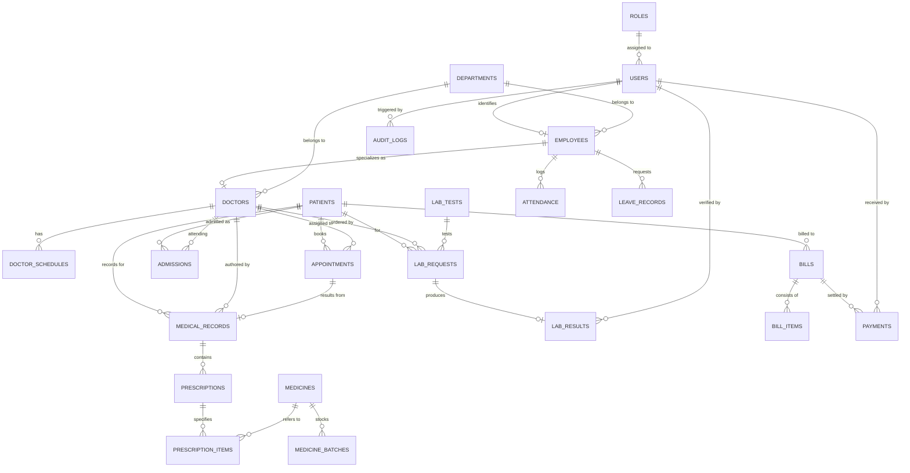

# Hospital Management System (HMS) — Database Design & Schema Specification

This document details the normalized relational database architecture designed for the Hospital Management System, based on the **Hospital Management System Software Specification Document**.

---

## 1. Architectural Principles
- **Relational Integrity**: Strict enforcement of Primary Keys (`id`), Foreign Keys with appropriate `ON DELETE` / `ON UPDATE` behaviors, and `UNIQUE` constraints to prevent data duplication.
- **Auditability**: Every transactional table contains `created_at` and `updated_at` timestamps. A dedicated immutable `audit_logs` table records every critical system mutation.
- **3rd Normal Form (3NF)**: Redundancy is minimized. Medicines, batches, lab test definitions, invoices, and bill items are separated cleanly into parent and child entities.
- **Performance**: High-frequency lookup columns (`mrn`, `email`, `status`, `appointment_date`, `doctor_id`, `patient_id`) are indexed.

---

## 2. Entity-Relationship Diagram (ERD)

---

## 3. Entity Catalog & Table Dictionaries

### 3.1 Authentication & Access Control
- **`roles`**: System roles (`Administrator`, `Doctor`, `Nurse`, `Receptionist`, `Laboratory Staff`, `Pharmacist`, `Accountant`).
- **`users`**: Secure login credentials, role binding, active status, last login timestamp.

### 3.2 Human Resources & Clinical Staff
- **`departments`**: Clinical and administrative departments (`Cardiology`, `Pediatrics`, `Emergency`, `Radiology`, `Pharmacy`, `Laboratory`, etc.).
- **`employees`**: Employee bio-data, contact info, hire date, salary, linked user account.
- **`doctors`**: Specialization, medical license number, consultation fee, assigned department.
- **`doctor_schedules`**: Day-of-week consultation slots, start/end hours, max patient quota.
- **`attendance`**: Daily clock-in/out timestamps and attendance state (`present`, `absent`, `late`, `on_leave`).
- **`leave_records`**: Leave applications, dates, reason, status (`pending`, `approved`, `rejected`), approving user.

### 3.3 Patient Management & Encounters
- **`patients`**: Master patient demographic profile, unique Medical Record Number (`mrn`), blood group, emergency contacts.
- **`appointments`**: Bookings, time slots, status (`scheduled`, `completed`, `cancelled`, `no_show`), triage priority.
- **`admissions`**: Inpatient admissions (IPD), room/bed number, ward category (General, Semi-Private, ICU), admission/discharge timestamps.

### 3.4 Electronic Medical Records (EMR)
- **`medical_records`**: Clinical encounter documentation, chief complaints, physical findings, clinical diagnosis, follow-up recommendations.
- **`prescriptions`**: Master prescription header linking medical record, patient, and doctor.
- **`prescription_items`**: Drug details, dosage, administration frequency (e.g., 1-0-1), duration, dispensing status.

### 3.5 Diagnostics & Laboratory
- **`lab_tests`**: Master catalog of lab tests, test codes (e.g., `CBC`, `LIPID`), standard reference ranges, units, and base fees.
- **`lab_requests`**: Requisitions ordered by doctors for patients, sample collection status.
- **`lab_results`**: Recorded clinical results, abnormal flag indicator, technician remarks, verification timestamp.

### 3.6 Pharmacy & Inventory
- **`medicines`**: Drug catalog, generic chemical name, brand name, drug form (Tablet, Syrup, Injection), reorder threshold.
- **`medicine_batches`**: Stock batches, batch numbers, remaining quantity, unit purchase price, expiration date.

### 3.7 Billing, Invoicing & Financials
- **`bills`**: Master invoice header, invoice number (`INV-YYYY-XXXXX`), subtotal, discount, tax, total amount, paid balance, status (`unpaid`, `partially_paid`, `paid`).
- **`bill_items`**: Line items for any service rendered (Doctor Consultation, Lab Test, Pharmacy Dispensation, Inpatient Bed Stay).
- **`payments`**: Payment receipts, settlement method (`cash`, `credit_card`, `bank_transfer`, `mobile_money`), external transaction reference.

### 3.8 Security & Compliance
- **`audit_logs`**: Immutable security log tracking user ID, action verb, target table, affected record ID, IP address, user agent, and payload.
